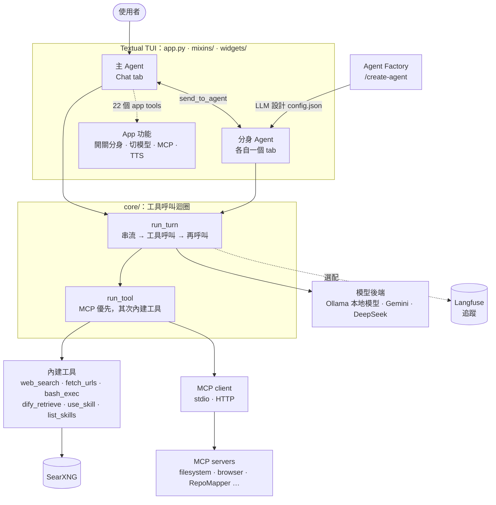

# Kai — 終端機裡的 AI 指揮塔

[](https://github.com/duncan-wen/kai/actions/workflows/ci.yml) [](https://www.python.org/) [](LICENSE)

用自然語言操作你的系統、一句話生出專業 AI 分身、串接 MCP 生態，全程不離開 terminal。


```
┌─ FileTree ─┬──── Chat / Agent Tabs ────┬─ Sidebar ─┐
│            │  messages                 │ model     │
│            │  streaming AI replies     │ context   │
│            ├───────────────────────────┤ git       │
│            │  [Think] [MCP]            │ MCP tools │
│            │  > prompt input           │           │
└────────────┴───────────────────────────┴───────────┘
```

## ✨ 為什麼是 Kai

### 🏭 Agent Factory：一句話生出專業 AI 分身

```
/create-agent 台股技術分析師，擅長 K 線、均線、籌碼分析
```

由 LLM 設計整份 agent 設定（system prompt、模型、暱稱、開場白；用途涉及朗讀時也會配好語音），存成 `agents/<name>/config.json`。每個分身開在自己的 tab，有獨立的對話歷史與記憶，可共用主 agent 的 MCP 工具，分身之間還能互相傳訊息分工。

### 🗣️ 用說的就能操作 Kai 本身

22 個 app tools 讓 AI 直接執行原本要手打的指令：「打開台股分析師」「切到 gemini-2.5-flash」「把 context7 MCP 加進來」，AI 會自己呼叫對應功能。

### 🔗 MCP 原生整合：不只是聊天，是真的能做事

支援 stdio 與 HTTP transport，設定分全域與專案兩層，執行中可以熱重載與增刪。Kai 會偵測掛上了哪些 MCP 工具（filesystem、browser、[RepoMapper](https://github.com/pdavis68/RepoMapper) 等），自動調整 system prompt 裡的使用規則：例如掛上 RepoMapper 後，AI 會先用 repo map 理解專案結構，而不是逐檔 `cat`。

### 📚 Skills：把專業流程打包給 AI

支援 [Claude Skills](https://github.com/anthropics/skills) 格式（`SKILL.md`）。放在 `<專案>/.kai/skills/` 或 `~/.kai/skills/`，AI 平常只看到每個 skill 的一行說明，需要時才用 `use_skill` 載入全文，不佔 context。`/skills` 列出所有 skill，也可以叫 AI 幫你建立新的 skill。

### 🔭 可觀測性：每一輪對話都追得到

選配 [Langfuse](https://langfuse.com)：`uv sync --extra observability` 安裝後，在 `.env` 填入 `LANGFUSE_*` 金鑰即啟用，每輪對話的模型呼叫、工具呼叫、token 用量與成本（含 cache 命中）都會被追蹤，Sessions 頁面可重播整段對話。上傳前會遮罩常見格式的密鑰；未安裝或未設定金鑰時完全不啟用。

### 🧩 不被單一供應商綁架

本地 Ollama（免費、資料不出機器）與雲端 Gemini、DeepSeek 隨時切換，對話歷史保留。特別針對 2–4B 的本地小模型調整過工具呼叫流程。

### 🖥️ 為活在 terminal 裡的人打造

Textual 打造的完整 TUI，不是網頁套殼：檔案樹、語法高亮檢視器、多 tab、命令面板、輸入歷史、`!` 直接執行 shell。另外支援 5 種 TTS 引擎，讓 AI 分身開口說話。

## 🚀 快速開始

需求：Python 3.13+、[uv](https://docs.astral.sh/uv/)；本地模型需要 [Ollama](https://ollama.com/)，網路搜尋需要 Docker。

```bash
git clone https://github.com/duncan-wen/kai.git && cd kai
uv sync                     # 選配：--extra tts（kokoro / melotts）、--extra observability（Langfuse）
cp .env.example .env        # 填入 API keys 與 SEARXNG_SECRET（openssl rand -hex 32）
docker compose up -d        # 啟動 SearXNG（web_search 用，可略過）
uv run python app.py                 # 在目前目錄啟動
uv run python app.py ~/my-project    # 指定工作目錄
```

只用雲端模型的話不需要 Ollama：在 `.env` 設 `MODEL=gemini-2.5-flash` 並填入 `GEMINI_API_KEY`，或設 `MODEL=deepseek-flash` 並填入 `DEEPSEEK_API_KEY`。

> [!WARNING]
> **安全須知**：Kai 的 AI 可以**不經確認**直接執行 shell 指令（`bash_exec`），權限等同啟動 Kai 的使用者，沒有沙箱。
> 網頁或檔案內容可能透過提示注入誘導它執行危險指令；在某個目錄啟動 Kai 時，該目錄 `.kai/mcp_servers.json` 裡的 MCP server 也會自動執行。
> 建議在容器或低權限帳號中使用、不要在不信任的 repo 裡啟動。完整說明與漏洞回報方式見 [SECURITY.md](SECURITY.md)。

## 🏭 Agent Factory

```
/create-agent 台股技術分析師，擅長 K 線、均線、籌碼分析
/create-agent --global 英文寫作教練          # 存到 ~/.kai/agents/，所有專案共用
/load-agent 台股技術分析師
/list-agents
```

每個 Agent 是一個目錄：

```
agents/
  台股技術分析師/
    config.json      ← model、system_prompt、nickname、tts、mcp_servers…
    history.json     ← 該 Agent 的對話歷史
    notes.md         ← /remember 寫入的長期記憶
```

`system_prompt` 支援 `{CWD}`、`{DATE}`、`{AGENT_DIR}` 與 `{{include:檔名}}`；改完 `config.json` 後執行 `/reload-agent` 即可熱更新，對話不中斷。完整欄位見 [docs/usage.md](docs/usage.md)。

## 🔗 MCP 整合

設定檔位置：`~/.kai/mcp_servers.json`（全域）、`<專案>/.kai/mcp_servers.json`（專案）。分身預設共用這些 MCP 工具，在 agent 的 `config.json` 設 `"mcp_servers": {}` 則不使用 MCP。

```json
{
  "mcpServers": {
    "filesystem": {
      "command": "npx",
      "args": ["-y", "@modelcontextprotocol/server-filesystem", "/home/user/projects"]
    },
    "my-api": {
      "type": "http",
      "url": "http://localhost:3000/mcp"
    }
  }
}
```

也可以在 Kai 裡直接加：`/mcp-add <name> <cmd> [args]` 或 `/mcp-add <name> --url <url>`。名稱加上 `_` 前綴即停用。詳見 [docs/mcp.md](docs/mcp.md)。

## 🧩 支援的模型

| 模型 | Thinking | Vision | Tools | 後端 |
|------|:---:|:---:|:---:|------|
| `qwen3-vl:4b`（預設） | ✓ | ✓ | ✓ | Ollama |
| `qwen3.5:2b` / `qwen3.5:4b` | — / ✓ | ✓ | ✓ | Ollama |
| `gemma4:e2b` / `gemma4:e4b` | ✓ | ✓ | ✓ | Ollama |
| `gemini-2.0-flash` | — | ✓ | ✓ | Gemini API |
| `gemini-2.5-flash` / `gemini-2.5-pro` | ✓ | ✓ | ✓ | Gemini API |
| `deepseek-flash` | ✓ | ✓ | ✓ | DeepSeek API |
| `deepseek-v4-pro` | ✓ | — | ✓ | DeepSeek API |

完整清單與新增方式見 `core/models.py`。執行中用 `/model <name>` 切換。

## ⌨️ 常用指令

| 指令 | 說明 |
|------|------|
| `/model <name>` | 切換模型（保留對話） |
| `/think` | 切換 Thinking 模式 |
| `/cls` | 封存並清除對話記憶（`/resume` 可恢復） |
| `/compact` | 壓縮對話歷史，釋放 context |
| `/ask <問題>` | 臨時提問，不寫入歷史（`/save` 可事後保存） |
| `/remember <內容>` | 寫入長期記憶 `.kai/notes.md` |
| `/image <路徑> [問題]` | 傳圖片給 vision 模型 |
| `/cd <路徑>` | 切換工作目錄（每個目錄有獨立歷史） |
| `/tts <engine\|off>` | 切換語音：`edge-tts` `azure-tts` `melotts` `kokoro-api` `kokoro` |
| `/skills` | 列出所有可用 skill |
| `!<command>` | 直接執行 shell 指令 |

完整指令與快捷鍵見 [docs/usage.md](docs/usage.md)。

## ⚙️ 設定

優先順序：`<專案>/.kai/config.json` > `~/.kai/config.json` > `.env` > 程式預設值。

`.env` 只放 API 金鑰（範本見 [.env.example](.env.example)），其他調校參數放 `config.json`。執行 `/init-config` 開互動面板查看每個值的來源並匯出，`/reload-config` 免重啟套用。

## 🏗️ 架構



| 目錄 | 職責 |
|------|------|
| `app.py` | 程式入口；`ChatApp` 組合所有 mixin |
| `core/` | 與 UI 無關的核心：`Agent` 工具呼叫迴圈、模型串流後端、MCP client、Agent Factory、設定、TTS |
| `core/tools/` | 內建工具：網路搜尋與抓取、bash、Dify RAG、skills，以及 `run_tool` 分派 |
| `mixins/` | `ChatApp` 的行為依職責拆分：串流、agent 管理、app tools、session、MCP、bash |
| `widgets/` | 自訂 Textual 元件：檔案樹、檔案檢視器、聊天訊息、各種對話框 |
| `prompts/` | Agent Factory 的設計 prompt |

幾個關鍵設計：

- **分層**：`core/` 不 import 任何 UI 元件，agent 邏輯可以獨立測試與重用。
- **工具並行**：模型一次要求多個工具時用 `asyncio.gather` 同時執行，並設呼叫次數上限。
- **分身隔離**：每個分身有自己的對話歷史、記憶與 chat lock；分身之間用 `send_to_agent` 非同步傳訊，單一分身出錯不影響其他 tab。
- **串流效能**：串流中只更新純文字，完成後才渲染一次 Markdown，避免長回應越跑越慢。

## 📖 文件

| 文件 | 內容 |
|------|------|
| [usage.md](docs/usage.md) | 使用手冊：指令、檔案樹、Session 管理、模型切換 |
| [mcp.md](docs/mcp.md) | MCP 設定、transport 類型、常用 server |
| [harness-architecture.md](docs/harness-architecture.md) | Agent 基礎設施架構 |
| [agentic-loop.md](docs/agentic-loop.md) | 工具呼叫迴圈的原理與實作 |
| [app-tools-design.md](docs/app-tools-design.md) | 讓 AI 操作 app 本身的設計 |
| [skill-system.md](docs/skill-system.md) | Skills：漸進揭露、雙層目錄、建立 skill |
| [langfuse-integration.md](docs/langfuse-integration.md) | Langfuse 可觀測性：設定、追蹤內容、遮罩 |

## 🤝 貢獻

歡迎 issue 與 PR！開發環境、PR 流程與 commit 慣例見 [CONTRIBUTING.md](CONTRIBUTING.md)，程式風格見 [CONVENTIONS.md](CONVENTIONS.md)，架構說明見 [DEVELOPMENT.md](DEVELOPMENT.md)。參與即表示同意遵守[行為準則](CODE_OF_CONDUCT.md)。送出前請確認：

```bash
uv run ruff check .
uv run ruff format --check .
uv run pytest tests/
```

版本變更紀錄見 [CHANGELOG.md](CHANGELOG.md)。

## 📄 License

[MIT](LICENSE)

第三方內容：`.kai/skills/langfuse/` 取自 [langfuse/skills](https://github.com/langfuse/skills)，著作權屬 Langfuse GmbH，以 MIT 授權（見該目錄的 [LICENSE](.kai/skills/langfuse/LICENSE) 與 [NOTICE.md](.kai/skills/langfuse/NOTICE.md)）。
